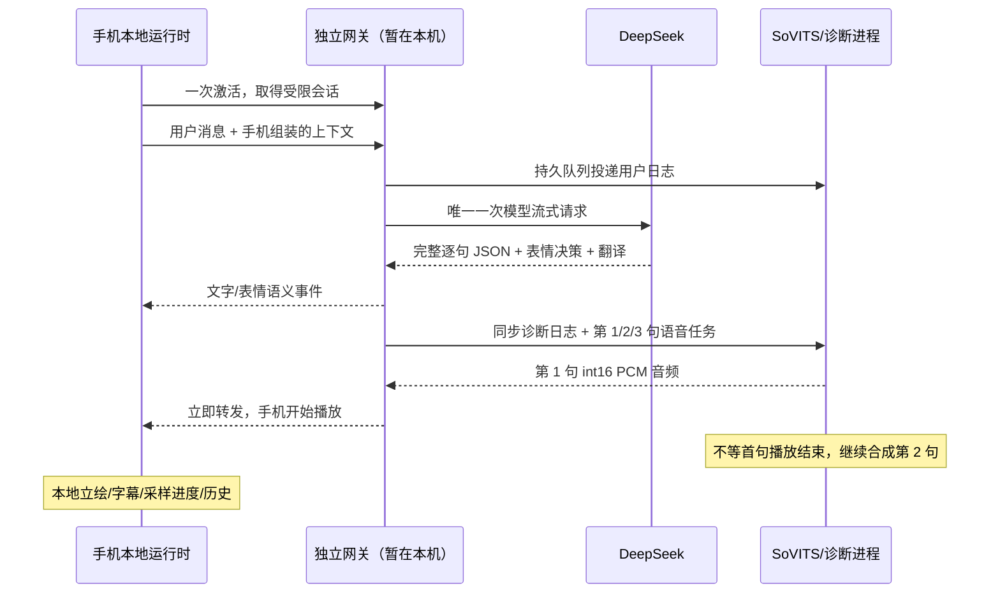

# 手机独立运行版 0.2.0：本地部署与交付

2026-10-24。方案跟踪：[Issue #2](https://github.com/voicepeak/ayana-agent/issues/2)。

已实现独立手机客户端、轻量网关和常驻语音/诊断进程，Android APK 已在 Windows 构建。用户授权公开推送代码/素材后，iOS 已通过 GitHub Mac/Xcode 26.0.1 编译并生成 **未签名 IPA**，安装到普通 iPhone 前仍需 Apple 签名，尚未完成实机安装验证。[成功构建记录](https://github.com/voicepeak/ayana-agent/actions/runs/40106800657)，构建代码为提交 `8c965e3`。

## 实际运行边界

用户确认没有独立服务器，先在这台电脑运行网关。因此当前电脑除 SoVITS 和日志外，**额外承担 DeepSeek HTTP 请求代理、鉴权、事件与音频转发**。网关和语音是两个独立进程，不启动桌面 AgentRuntime，不读取桌面全局会话，不广播桌面状态。将来把网关迁到另一台服务器后，语音进程仍只需向网关主动连接。



- 手机：本地角色提示词、上下文裁剪、显式记忆、IndexedDB 历史、话题、服装/表情映射、资源、主题、播放器及取消。两个角色的 WebP 立绘资源随包内置（约 24 MB），不会请求电脑立绘目录。
- 网关：自定义密钥只保存哈希，签发 15 分钟访问会话与 30 天轮换刷新会话；每用户最多 5 个设备、每分钟 12 轮、全局最多 4 个同时进行的模型请求。DeepSeek 主 Key 仅由网关读取。默认本地配置以 Windows DPAPI 保存，未写入手机包。
- 语音进程：复用常驻 SoVITS Worker，串行合成，有界预取 3 句。后台发送音频时不阻止下一句合成。不同用户的 generation 重新分配，取消不共用客户端整数。
- 诊断：SQLite 按用户/turn 保存用户消息、模型逐句输出、翻译、结束状态及 TTS 耗时/失败类型。日志 ACK 独立于音频发送；网关先持久入队，再向电脑投递并去重。当前支持 SQLite 查询，尚无管理界面。
- 播放进度留在手机；只有音频结束/失败/取消发回消费确认，用于释放预取名额。不会发送 10 Hz 播放进度。

## 立即跨网使用

1. 将 `release/mobile/Ayana-0.2.0-android.apk` 安装到 Android。此包使用开发调试签名，仅供本地测试；没有发布到商店，也未接入自动更新。
2. 公网模式支持蜂窝或其他 Wi-Fi；手机无需安装 Tailscale。网关电脑需已登录允许 Funnel 的 Tailscale 账号。此部署复用电脑既有域名，HTTPS 根路径从旧版 17321 切换到独立网关 17330。
3. 电脑运行以下命令。配置脚本从当前 `config/local.json` 复制 SoVITS 配置，从本机已有 DPAPI 凭据读取 DeepSeek Key；不会在终端输出 Key。无需启动桌面应用。

```powershell
cd D:\ayana-agent
.\scripts\start_mobile_independent.ps1
.\scripts\enable_mobile_public.ps1
Get-Content .runtime\mobile-services\activation-code.txt
```

4. 在手机激活页粘贴完整的 `ayana1.…` 激活码。它包含网关地址和用户随机密钥，不是加密文本，需像密码一样保管。手机无需另外输入 DeepSeek/TTS 地址或主 Key。
5. 浏览器试用入口是脚本输出的 HTTPS 地址，支持 Safari“添加到主屏幕”作为无需原生签名的网页使用方式。其实际播放、安装和后台行为仍需 iPhone 实机验证。原生安装包内置立绘，初次网页访问则需要下载资源；二者不能用网页首次资源下载耗时作语音延迟对比。

已有旧激活的手机需退出激活，再粘贴电脑上重新生成的公网激活码；退出保留本地历史。地址保存在 `gateway.json` 的 `public_url`，后续普通启动不会回写成局域网 IP。激活用户密钥保持原值。语音 Worker 始终只连接本机 `127.0.0.1:17330`。

服务已经运行时重复启动会提示 PID，停止后再启动：

```powershell
.\scripts\stop_mobile_independent.ps1
.\scripts\start_mobile_independent.ps1
```

如自动选址不对，可传 `-GatewayUrl http://你的电脑局域网IP:17330`。脚本优先选有网关的实体网卡，避免把 VPN/TUN 虚拟网卡地址写进激活码。

Windows 防火墙如提示需允许 Python 在**专用网络**接收连接。网关监听 TCP 17330；语音 Worker 不开放额外入站端口。未自动修改系统防火墙规则。路由器 AP 隔离、访客 Wi-Fi 隔离、电脑休眠都会影响访问。

公网入口由 Funnel 提供 HTTPS/WSS，不需要路由器端口映射、另购域名或每台手机加入私网。Funnel 只承担网络传输，网关仍执行鉴权、受限会话和逐句分发，不会恢复桌面状态广播。它有中继带宽和网络可达性限制，不能保证各运营商相同延迟。[官方 Funnel 说明](https://tailscale.com/docs/features/tailscale-funnel)。

`enable_mobile_public.ps1` 会在本机保存原入口配置到 `.runtime/mobile-services/funnel-before.json`，只更新 443 根处理路径，不重置其他入口。关闭公网命令为 `tailscale funnel --https=443 off`；重新启用执行同一脚本。`--bg` 的入口配置可随 Tailscale 重启恢复，但网关和 SoVITS 进程需另行启动，电脑休眠/断网时服务不可用。[官方持久运行说明](https://tailscale.com/docs/reference/tailscale-cli/funnel#effects-of-rebooting-and-restarting)。

若只想局域网测试，可显式传 `-GatewayUrl http://电脑内网IP:17330`，此时 HTTP 不提供 TLS 保护，仅用于可信 Wi-Fi，不能直接映射公网。Android/iOS 暂保留此测试例外。

## 本地资料与日志

| 路径 | 用途 |
| --- | --- |
| `.runtime/mobile-services/activation-code.txt` | 当前用户的完整激活码，不进入安装包或 Issue |
| `.runtime/mobile-services/gateway.json` | 网关配置和服务间凭据；不包含明文 DeepSeek Key |
| `.runtime/mobile-services/deepseek.dpapi` | 当前 Windows 用户加密的 DeepSeek Key |
| `.runtime/mobile-services/worker.json` | SoVITS 模型/参考音频配置及网关服务凭据 |
| `.runtime/mobile-services/gateway/gateway.sqlite3` | 用户/会话哈希、去重 turn、有界日志 outbox |
| `.runtime/mobile-services/worker/dialogue.sqlite3` | 对话诊断事件库，非手机历史库 |
| `.runtime/mobile-services/*.log` | 网关/语音启动与异常日志 |

新服务数据与桌面端资料独立。旧 17321 端口薄客户端协议不再是新手机端的接入方式。当前配置一个 owner 用户；服务 Store 支持新增/撤销独立用户，尚未制作批量发码管理界面。退出激活保留该用户手机本地历史，卸载原生应用会丢失本地资料，暂未提供导出/恢复。

## Android 重建

已内置角色资源；源素材发生改变时才需先运行 `.venv\Scripts\python.exe scripts/build_mobile_resources.py`。

```powershell
cd apps\mobile
npm ci
npm run build
npx cap sync android
cd android
.\gradlew.bat assembleDebug
```

需要 Node 22+、JDK 21 和 Android SDK 36。当前主机还提供 `D:\android-build\gradle\gradle-8.14.3\bin\gradle.bat` 与镜像初始化文件 `D:\android-build\init.gradle`。APK 原始输出位于 `apps/mobile/android/app/build/outputs/apk/debug/app-debug.apk`，`python scripts/package_mobile.py` 生成交付目录与 SHA256 清单。

## iOS 签名和构建

普通 iPhone 执行原生应用需要 Apple 签名；“生成未签名 IPA”不能绕过安装要求。[Apple 代码签名说明](https://support.apple.com/en-euro/guide/security/sec7c917bf14/web)。

可以用免费 Apple Account 的 Personal Team 在自己的设备测试，不必先购买开发者年费；其描述文件 7 天过期，需要重新构建安装。[Apple 开发者账户说明](https://developer.apple.com/help/account/basics/about-your-developer-account)。这仍然是签名，不是免签。

交付的 `Ayana-0.2.0-ios-project.zip` 包含 React 源码、内置角色资源、Xcode/SPM 工程及脚本，解压后在 Mac 执行：

```bash
# 需要 Node 22+ 和 Xcode 26+；先在 Xcode 设置里登录自己的 Apple Account。
bash scripts/build_mobile_ios.sh
# 默认产出未签名 IPA，供后续签名；不能直接安装普通 iPhone。

# 自己的 Mac 已有签名账户和已注册设备时：
APPLE_TEAM_ID=自己的TeamID AYANA_IOS_BUNDLE_ID=自己的唯一BundleID \
  IOS_DEVICE_ID=自己的设备UDID bash scripts/build_mobile_ios.sh
```

安装开发版本也可直接用 Xcode 打开 `apps/mobile/ios/App/App.xcodeproj`，选择 App → Signing & Capabilities → Personal Team，选择已连接 iPhone 后运行。签名证书、密码不应发送到聊天或提交仓库。Keychain 原生凭据插件已通过 iOS 编译，读写与权限行为仍待实机验证。[Capacitor 8 环境要求](https://capacitorjs.com/docs/getting-started/environment-setup)。

`.github/workflows/mobile-ios.yml` 已在公开分支 `codex/mobile-independent` 执行成功，提供 `Ayana-0.2.0-ios-unsigned.ipa` 和云端 SHA256 校验文件。首轮 macOS Bash 空数组兼容问题已修复，第二轮编译、ZIP 完整性检查和产物上传全部通过，耗时约 1 分 59 秒。没有向构建环境提供 Apple 凭据或本机服务凭据。

没有自己的 Mac 也可使用云构建的 IPA，在 Windows 通过自己的免费 Apple 账号签名安装；详见 [iPhone 安装步骤](MOBILE_IOS_INSTALL.md)。这仍然需要签名。公网 HTTPS 网页可通过 Safari 添加到主屏幕使用，不需要原生代码签名；不能承诺与原生相同的离线、音频和后台能力。

## 验证与未完成事项

- 最新后端全量回归通过 411 项、跳过 5 项，其中独立手机测试 12 项通过。模型 SSE 逐字符分片、重复消息、刷新撤销、日志去重/满队列、慢音频网络不停止下一句合成均有覆盖。
- 真实 DeepSeek → SoVITS → 协议客户端：两句音频在约 1.75/2.83 秒到达，合成约 0.87/1.07 秒；日志落库核对通过。这里只是一次热机合成测试，不是延迟 SLA。
- Chrome 手机视口：激活、真实双句音频、播放回执、立绘资源、本地角色/称呼/记忆持久化通过；localhost 安全环境断网重载通过。LAN HTTP 的 HTMLAudio 降级播放也通过浏览器测试。远端命令仅见 `turn.start`、`audio.consumed`。
- TypeScript/Vite、Capacitor Android/iOS 资源同步、Android Gradle 构建、iOS Xcode arm64 Release 编译和 IPA 打包通过；生产 JS 依赖 npm audit 未报告漏洞。**没有连接 Android/iPhone 实机**，原生安全存储、系统后台行为、手机真实 Wi-Fi 延迟仍待实机验收。
- 第一版只提供文字输入和语音回复。尚未接入独立 STT 或搜索服务，麦克风明确禁用，不会暗中调用电脑 STT/工具。
- 记忆支持手工保存和“记住…”语句，长上下文在手机裁剪；尚未迁移桌面的自动摘要与所有工具。单句内部仍为整句 PCM，逐句流水线已实现。
- 未提供完整日志管理界面、手机历史导入导出、云端用户门户、商店发布和正式发布签名。
