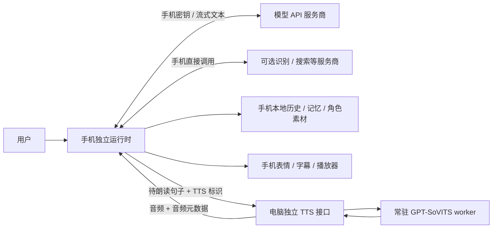

# 手机独立运行，电脑仅提供 GPT-SoVITS 推理：设计方案

> 历史方案：用户于 2026-10-24 重新设定统一接入密钥、电脑对话日志及双路分发。当前设计以 [修订设计核查](MOBILE_UNIFIED_ACCESS_REVIEW.md) 和 Issue #2 最新正文为准。本文保留旧方案的代码核查背景，不再作为最新职责约定。

日期：2026-10-24。状态：待评审的设计方案，本 Issue 不代表已完成重构。

## 1. 目标与硬边界

手机成为完整客户端：用户在手机配置模型 API，手机直接请求模型服务商，接收并解析返回文本，把需要朗读的句子发送给电脑的 GPT-SoVITS 服务，电脑只返回音频。聊天业务不再通过电脑中转。

**电脑只承担语音推理及其必需的接口配套；任何新增的非 TTS 电脑职责，都必须先向用户说明并另行确认，不能作为兼容、降级或调试路径偷偷加入。**

手机负责：API 配置与密钥、模型流式请求、角色提示词、上下文、历史和记忆、摘要与翻译请求、模型输出解析、工具编排、立绘与表情选择、素材读取、字幕、音频播放与同步、录音与识别、打断和重连。

电脑只负责：加载/预热 SoVITS 模型、模型必需的文本前处理与参考音频缓存、语音合成，以及接口鉴权、有限推理任务队列、取消、音频封装和最小健康信息。这里的“文本前处理”是发音/音素等模型输入处理，不包括改写回复、翻译或选择表情。

这些接口配套是让手机能够调用推理的必要工作。**没有已知必须额外经过电脑的聊天业务逻辑。** 不要求手机运行 Torch，也不把 SoVITS 搬到手机。

## 2. 现状核查与问题定位

核查对象是当前本地工作区，包含尚未提交的手机端改动；不能假设下列全部文件已在远端 main。以下是代码事实，不是实际延迟测量结果：

| 位置 | 当前行为 | 影响 |
| --- | --- | --- |
| `docs/MOBILE.md` | 明确规定 PC 负责模型流式输出、GPT-SoVITS、SQLite 历史和记忆 | 手机是远程客户端，缺少独立运行时 |
| `scripts/start_mobile_server.ps1`、`services/agent/__main__.py`、`server.py` | 手机服务启动的是 `services.agent`；创建并启动 `AgentRuntime` | 同时带入桌面能力、存储、提示词、模型、记忆和后台逻辑 |
| `apps/mobile/src/bridge.ts`、`api.ts` | 连接 `/ws?client=mobile`，请求 settings/history/conversations/capabilities；发送 `turn.start` | 手机没有直接请求模型；依赖电脑会话状态 |
| `services/agent/runtime.py` | `emit()` 持久化事件后遍历全部客户端广播；手机主要只变更音频传输格式 | 当前通用通道没有按手机/桌面隔离业务事件和会话 |
| `runtime.py::_connected()` | 推送桌面状态；有已有 snapshot 时也推送；另推能力、会话、记忆 | 手机会收到不需要的桌面运行时信息，但不能据此称它在传输“电脑全部状态” |
| `apps/mobile/src/App.tsx`、`api.ts` | 使用电脑给出的 `asset_id`，通过 `/assets/{asset_id}` 读取图片 | 首次显示/切换未缓存立绘依赖电脑和网络 |
| `runtime.py::_reserve_audio()`、手机播放器 | 电脑管理待播预算，手机回传播放进度 | 播放与电脑队列耦合，共用运行时会互相干扰 |
| `runtime.py::_transcribe()` | 手机录音交给电脑 STT | 识别也占用电脑，不符合新边界 |
| `services/tts/adapters/sovits.py` | 内部分段后合成并拼接，整次 `synthesize()` 完成才返回 | 当前不是模型边生成边返回音频，不能仅换 WebSocket 就宣称实现真流式 |
| `providers/model.py` | DeepSeek 分支启用思考及较大输出上限 | 可能影响首句时间，应单独评估；不是已测出的延迟根因 |

结论：现有业务依赖需要拆除。重复广播、电脑计算、推理速度、网络路径各自的延迟占比仍需测量；目前不能承诺重构后的具体毫秒数或改善倍数。

Tailscale 是网络传输层，不负责决定应用同步哪些状态。官方文档说明直连通常有更低延迟，无法直连时可能走中继，因此网络路径也要检查，但换掉 Tailscale 不能替代业务拆分。依据：[Tailscale connection types](https://tailscale.com/docs/reference/connection-types)。

## 3. 目标架构与数据流



1. 手机本地读设置、角色包、历史和记忆，组装提示词及能力清单。
2. 手机直接向配置的模型 API 发起请求；边接收边解析 SSE 与结构化 speech/translation 事件，保存手机本地消息。
3. 模型给出一句完整、通过校验的 `speech_ja` 后，手机立即提交 TTS，不等整轮回复或翻译结束。保留当前日语声音的能力边界，其他语言必须有对应已验证的声音配置。
4. 手机依据同一条 speech 的 expression/pose、服装与本地角色目录完成表情路由，得到本地素材地址；不向电脑请求 `asset_id`。
5. 电脑仅校验 TTS 请求并排队推理，返回与请求对应的音频。
6. 手机按自己的播放时钟驱动字幕、表情和已播状态，并在本地保存进度；每 100ms 的播放进度不再上传电脑。
7. 手机一边播放，一边继续接收模型文本和预取后续句子的音频。推理失败时保留可读文本，不阻塞聊天、表情或历史。

## 4. 职责分配与可用性

| 能力 | 手机如何承担 | 电脑是否参与 |
| --- | --- | --- |
| 模型配置、API Key、请求与重试 | 手机设置 + 原生安全存储 + 手机直连 API | 否 |
| 人设、提示词、上下文预算、摘要、记忆提取、情绪状态 | 手机本地实现；需要模型的计算由手机直接调用 API | 否 |
| 会话与历史、部分播放记录、翻译、使用量 | 手机本地数据库和状态管理 | 否 |
| 联网搜索、工具调用 | 手机能力注册表，手机直连工具服务商，手机维护工具循环 | 否 |
| 立绘、表情、动作、服装、背景、字幕 | 手机本地角色资源与渲染；手机依据实际展示记录更新上下文 | 否 |
| 麦克风、按住说话、语音识别 | 手机录音；首版提供手机直接调用的可配置 STT API，系统/本地识别作为经真机验证的可选适配器 | 否 |
| 音频队列、音量、字幕时钟、打断、恢复 | 手机播放器与运行时 | 否 |
| GPT-SoVITS 权重、参考音频、模型前处理及推理 | 电脑常驻推理 worker | 是，仅推理 |
| TTS 鉴权、任务取消、音频传输、服务健康 | 电脑独立 TTS 接口 | 是，推理配套 |
| 电脑观察、截图、Windows 工具 | 手机能力清单不提供；若需手机对应能力，另做受系统权限约束的手机实现 | 不调用电脑 |
| 手机与桌面同步 | 默认不做；需要迁移用离线文件导入，持续同步另行设计 | 不在本方案增加同步服务 |

电脑离线时：手机仍能启动、配置 API、聊天、保存/切换会话、展示和切换立绘、翻译；GPT-SoVITS 语音暂不可用，界面明确提示并显示完整文字。手机关网时本地历史和素材仍可使用，在线模型当然仍需要访问服务商。

## 5. 手机端技术方案

### 5.1 发布形态与模块

以现有 React + TypeScript + Capacitor 本地打包应用为主，先 Android、再 iOS 真机验证。保留可复用的界面和纯函数，替换远程 Agent 依赖，不引入 Electron 或整套 Python 后端。

拟新增/调整的模块（设计名称，尚未实现）：

- `runtime/`：手机会话状态机、轮次、事件总线、取消与生命周期。
- `providers/`：手机模型请求、SSE 解析、输出校验/修复、工具调用、翻译与 STT 适配器。
- `prompts/`：从仓库角色源文件打包的提示词，以及本地上下文/记忆/预算逻辑。
- `storage/`：原生持久化数据库；浏览器版本使用 IndexedDB。密钥不进入普通数据库、日志或 localStorage。
- `characters/`：版本化角色资源清单、表情与动作解析、素材预加载。
- `tts/`：仅调用电脑的语音接口，负责请求标识、缓冲和取消。
- `playback/`：音频时钟、队列、字幕进度、实际已播记录。
- `capabilities/`：手机可用工具清单和权限，不能照搬 Windows 能力。

不在运行时导入桌面 IPC、Windows 模块或 `AgentRuntime`。提示词、表情目录、协议 schema 等静态源可通过构建脚本复用；这属于代码/资源复用，不形成电脑运行依赖。Python 运行时逻辑移植为手机实现，并使用固定输入输出样例验证语义。

### 5.2 模型 API 与密钥

- 手机分别配置模型 API 地址、模型名、Key、采样/思考选项；TTS 地址和令牌是另一个设置项，两套凭据不混用。
- API Key 使用 Android Keystore / iOS Keychain 支持的安全存储适配器，不能沿用当前明文 localStorage 的令牌存储方式；首版用户手动配置，不从电脑读取密钥。
- 原生端实现可取消、可增量回调的原生 HTTP 流式传输桥，避免依赖供应商给 WebView 开放 CORS；不能使用“请求结束才一次性返回”的伪流式桥。验证 UTF-8/SSE 跨网络块拆分、多字节字符、错误与取消。
- 模型输出的 JSON、表情与工具参数全部在手机校验。模型格式修复请求也由手机直连服务商。
- 长思考、自动翻译、摘要等分别计时；后台摘要不阻塞首句朗读。保留用户选择，不把降低回复质量作为架构提速前提。
- 若保留纯 PWA，明确它受供应商 CORS、浏览器存储和后台策略限制，不能静默让电脑代理模型请求。PWA 是后续兼容项，不能作为本次独立手机端的唯一交付。

### 5.3 资源与界面

- 角色立绘、表情映射、动作规则、字体及界面随安装包或独立资源包安装到手机。首版至少包含可用的默认角色；后续可从独立静态分发源下载资源，运行中不从电脑按张取图。
- 根据手机 GPU/内存选择分辨率档位和有界解码缓存；展示前预加载需要的表情，避免一次解码全部大图。
- 当前服装、表情兜底、冷却、最近实际展示记录在手机维护；保留现有表情语义，不退化为随机换脸或关键词映射。
- 原生包使用本地 `dist`，移除正常运行时依赖 `AYANA_MOBILE_URL` 远程加载电脑页面的配置；手机独立启动不访问 `/mobile/bootstrap`。

## 6. 电脑 TTS 服务与协议

### 6.1 进程边界

新建独立入口，例如 `python -m services.tts_server`，仅加载专用 TTS 配置并创建 `TtsService`/worker；它不能导入或实例化 `AgentRuntime`、`WindowsDesktop`、历史库、提示词、记忆、STT 或模型 API 客户端。没有模型 API Key 也必须能正常提供语音服务。

首版电脑只启动这一套常驻 SoVITS worker，保留已有参考状态缓存与预热。关闭桌面应用不影响 TTS 服务。原桌面功能维持自身运行方式；如果两端同时开，独立 worker 可能造成权重重复驻留/显存争用，需要明确测量，不能声称架构拆分能消除 GPU 竞争。

后续若桌面也接入同一个推理服务，只共享推理调度和音频，仍不共享 Agent、会话或播放状态；此项可另开实施任务。

### 6.2 接口草案

- `GET /tts/v1/health`：版本、ready/loading/failed、支持的音频格式、采样率和服务允许的声音 ID。不返回桌面状态、文件路径、个人配置或聊天信息。所有 TTS 接口均校验专用设备凭据或有效票据。
- `POST /tts/v1/ticket`：用独立可撤销的设备令牌换取短期、一次性的 WebSocket 票据。原生端也可使用握手 Authorization；票据和令牌均不进入访问日志。
- `WS /tts/v1/stream`：只接受推理、取消及必要的连接控制消息，拒绝旧的 `turn.start`、settings/history/memory/playback 等命令。

手机提交的业务字段仅限：

```json
{
  "type": "tts.synthesize",
  "protocol_version": 1,
  "request_id": "phone-generated-uuid",
  "generation_id": "phone-turn-uuid",
  "utterance_id": "phone-sentence-uuid",
  "text": "こんにちは。",
  "voice_id": "ayana-default",
  "language": "ja",
  "audio_format": "pcm_s16le"
}
```

请求不含模型 Key、历史、记忆、提示词、翻译、表情、服装或截图。允许的 `voice_id` 映射到服务端已有模型，不能提交任意本地路径或远程参考音频 URL；语言能力由服务端声明并校验。

控制事件：`tts.accepted`、`tts.audio`、`tts.completed`、`tts.cancelled`、`tts.error`。服务端为接受的请求分配 `job_id`，每条响应携带 request/generation/utterance/job 标识；不广播给其他连接。

音频采用带头部的二进制帧，头部至少包含协议版本、job 标识、chunk 序号及 payload 长度。`tts.audio` 元数据声明实际采样率、声道、格式、样本数和字节数；客户端校验后按请求重组，不能只用“上一条 JSON 对应下一帧”的单槽假设。完成事件明确总块数与总样本数。

首版采用 PCM s16le 单声道、模型实际采样率，沿用手机 PCM 播放能力。每句完成推理即回传，可分帧发送以避免单帧过大；这属于逐句流水线，**不是** SoVITS 模型内部流式推理。真正的模型音频流式输出另做兼容性与声音质量验证。

PCM 吞吐按 `采样率 × 声道数 × 16 bit` 计算：32kHz 单声道为 512kbps，不代表当前所有声音都固定 32kHz。首版不把 Opus/AAC 作为前置条件；只有实测带宽造成瓶颈时再比较编码开销、解码支持和音质。

### 6.3 隔离、背压与取消

- 手机拥有逻辑播放队列，起始预算为最多 3 句或约 8 秒的预取音频；根据实测调整。模型文本接收与本地保存不被 TTS 背压阻塞。
- 服务端只维护有界推理任务：初版单 worker、单执行任务、每设备最多 2 个待执行任务，并设总容量/时长限制。满额明确返回 `queue_full`/`busy`，手机保留待合成文本并可取消重试，不能堆积无界等待。
- 服务端不等待播放进度来判断下一次是否推理；手机以提交节奏控制预取，服务端只按自身推理容量调度。
- 服务端以已鉴权设备 + 连接/会话 + generation + request 建立隔离。现有 worker 只有整数 generation，必须由网关映射到全局唯一内部 generation，再调用现有取消接口，不能直接复用各手机自增数字。
- 用户打断时，手机立刻停止播放、清空未播音频、取消模型 HTTP 请求，并发送 `tts.cancel`。本地新轮次无需等待电脑取消确认；延迟到达的旧音频按 generation 丢弃。
- GPU 运算可能只能在现有检查点协作取消，取消 ACK 不代表 GPU 指令已经即时终止；新任务排队时间必须单独展示与测量。
- 连接断开后取消其无用的排队/执行任务，短暂保留必要的终态去重记录。同一请求重复提交在保留窗口内不得重复推理；超出窗口明确以新请求重试。首版断线不自动补播旧轮次，重播由手机上的用户操作触发。
- 错误只返回安全的类别与简短原因，不暴露服务器路径、完整堆栈或其他设备文本。语音正文仅在推理所需内存中短暂保留，不写入电脑聊天历史。

## 7. 网络选择：不让网络层决定业务架构

- 手机的模型/STT/搜索请求使用手机网络直接访问对应服务商；不配置为经电脑出口转发，不启用电脑充当这些请求的 HTTP 代理或 Tailscale exit node。
- 手机到电脑只连接独立 TTS 地址。局域网优先提供可配置的直连入口；异地初版可保留 Tailscale 作为可替换传输，应用不硬编码 `.ts.net` 地址。
- 电脑 TTS 的鉴权与 TLS 根据部署入口配置。需要 HTTPS 代理时仅代理独立 TTS 服务端口，不继续把旧 `17321` Agent 服务整体暴露给手机。
- 连接配置区分模型地址与 TTS 地址；不能因为没连电脑而挡住首页、API 设置和文字聊天。
- 使用 Tailscale 时检查 `tailscale ping`、`tailscale status` 的 direct/relay 状态，在局域网直连、Tailscale 直连和中继情况下分别测量。没有实测前不认定 Tailscale 是主要瓶颈，也不承诺替换网络就能解决推理慢。
- 不要求增加新的自建中转服务。未来若为异地访问增加中转，只能转发 TTS 通信，须先说明延迟、部署与成本影响；业务职责扩展仍须另行确认。

## 8. 实施顺序与交付物

本次仅提交设计。以下是评审通过后的执行顺序：

1. **建立基线和协议**：记录当前手机版本调用图和阶段耗时；确定 TTS schema、错误、隔离与取消规则、手机能力清单。
2. **抽出独立 TTS 服务**：专用配置/令牌/启动脚本，复用现有 SovitsEngine 与缓存，验证不启动 Agent/桌面/历史/STT；用测试客户端完成合成与取消。
3. **手机独立聊天闭环**：本地启动、API 设置和安全存储、可增量的原生网络桥、模型事件解析、本地历史/上下文/记忆；电脑离线仍完成文字聊天。
4. **迁移角色与表现**：本地资源包、表情路由、服装/动作、字幕、实际展示记录和情绪；检验与现有角色行为一致。
5. **接入 TTS 和本地播放**：逐句流水线、预取预算、打断、失联文字降级、旧包丢弃；移除手机对通用 `/ws`、bootstrap、`/assets` 的正常运行依赖。
6. **补齐手机能力**：录音与手机直连 STT、翻译/搜索/工具循环，摘要维护、导入导出与应用生命周期；不可实现的 Windows 专属能力明确关闭。
7. **真机验收与发布**：Android 先验，iOS 独立验证流式网络/音频/权限/切后台；更新安装包、文档和验证脚本，再停止推荐旧“电脑代理全部逻辑”的手机模式。

迁移不自动读写桌面历史库或复用桌面 API Key。需要旧数据时，提供用户主动导出、手机离线导入的文件流程；导入失败不损坏既有数据。

## 9. 验收标准

### 架构硬验收

- [ ] 关闭桌面 Ayana 和旧 Agent 服务，仅启动独立 TTS，手机完成模型 API 直连、收文本和语音播放。
- [ ] 关闭电脑或断开 TTS，手机可启动、配置/切换 API、文字聊天、访问历史/记忆、切换服装与立绘、翻译；只提示语音不可用。
- [ ] 手机新装应用已有默认立绘；电脑 `/assets` 不可访问时仍能展示/切换所有已安装素材。
- [ ] 录音与识别不上传电脑；识别服务未配置时明确提示，不回退到电脑 Whisper。
- [ ] 推理进程依赖/启动检查证明没有 AgentRuntime、WindowsDesktop、ConversationStore、提示词组装、LLM 或 STT 初始化；允许仅存储 TTS 专用配置和设备凭据。
- [ ] 手机与电脑间抓包/端点日志只出现 TTS 鉴权、健康、推理文本、取消和音频；不出现聊天上下文、API Key、立绘、桌面快照或播放进度同步。
- [ ] 两手机或手机与桌面并用，不串文本、不串音频，不跨设备取消；显存争用与排队被明确记录。
- [ ] 打断本地立即生效，旧音频不复活；重连不自动重播；电脑错误不清除手机历史或卡住下一轮。

### 性能与行为验收

- [ ] 测量手机端阶段：发送、模型首字节、首个有效 speech、TTS 提交、音频首包、实际开始播放；服务端独立报告排队/推理/封装时长，不直接相减两设备未经同步的绝对时钟。
- [ ] 首句耗时分解为：模型首句时间 + 手机处理 + TTS 网络/排队/推理 + 手机启动播放；翻译、表情和完整回答收尾不阻塞首句提交。
- [ ] 在相同手机、模型选项、声音、文本和网络下，对比旧版/新版；冷启动和预热分开，每种条件至少 20 轮，报告中位数、P95、失败/打断率及电脑 CPU/RAM/GPU/显存。暂不填写未经实测的延迟承诺。
- [ ] 分别覆盖 Wi-Fi/蜂窝、局域网直连/Tailscale 直连/中继、弱网断线、连续打断、长回复、模型格式错误、TTS 队列满和电脑休眠。
- [ ] 对提示词/上下文预算/输出解析/表情兜底使用固定样例做跨端一致性验证；播放中表情、字幕与部分播放历史采用手机实际采样时钟，不使用网络进度广播。
- [ ] Android/iOS 流式请求、麦克风权限、音频输出、系统中断和切后台各有真机结果；不能把 WebView 后台长期常驻作为默认保证。

## 10. 设计决策

本方案确定的边界是：**手机独立 Agent，电脑独立 TTS**。保留现有移动界面的可用部分，但彻底替换其对桌面运行时的依赖。Tailscale 可作为语音链路使用，既不是业务运行时，也不再承载桌面状态同步。除前述推理接口配套外，没有增加任何需要经过电脑的功能。
