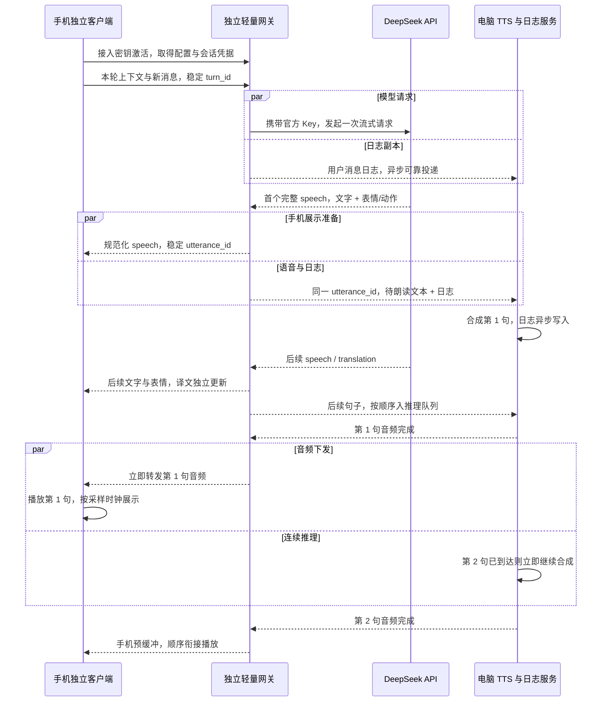

# 独立网关统一接入、电脑对话日志与逐句语音流水线：设计方案

日期：2026-10-24。状态：独立手机/网关/SoVITS 日志链路已实施并完成本地联调；Android 测试包和云端 Mac 编译的 iOS 未签名 IPA 均已生成，iOS 安装仍待个人签名和实机验证。本文根据用户最新设定修订 Issue #2；旧方案中“电脑不保留对话日志”“用户手动配置所有后端”等约束已被本次要求替代。

**最新部署决定**：用户确认没有服务器，先本地部署独立网关。当前电脑除推理/日志外，还运行网关以承担 DeepSeek 请求、鉴权与音频转发，官方 Key 因而暂存本机网关；手机逻辑不回桌面 Agent。本文件以下的“三方职责”是可拆分部署目标，本地原型的实际边界和验证见 [MOBILE_INDEPENDENT_DELIVERY.md](MOBILE_INDEPENDENT_DELIVERY.md)。

## 1. 核查结论

最新链路可行，目标是让用户只输入我们发放的接入密钥，就能使用 DeepSeek 文本生成、电脑 SoVITS 语音，以及电脑上的对话问题排查日志。立绘、服装、实际表情展示、字幕、播放器、上下文和手机交互继续由手机管理，不回到桌面整套 Agent。

需要补齐三个协议事实：

1. 自定义密钥鉴权我们自己的独立网关。DeepSeek 官方接口仍要求有效的 DeepSeek API Key；官方凭据只保存在网关，不下发手机，也不放在推理电脑。
2. DeepSeek 的一条流式 HTTP 响应返回给独立网关，再由网关分发给手机和电脑；不是给模型填两个接收地址。
3. “首句完成立即播放，第二句继续推理”可通过逐句流水线实现；能否持续无等待，还取决于后续文本到达、单句推理时间和网络，不是绝对保证。

依据：[DeepSeek 首次调用与 API Key](https://api-docs.deepseek.com/)、[Chat Completions 流式接口](https://api-docs.deepseek.com/api/create-chat-completion/)。表情字段是我们通过提示词与结构化协议约定的内容，并不是 DeepSeek 接口自动附带的标准字段。

## 2. 已确认的职责边界

已确定：

- 用户只输入一枚我们发放的密钥，不需要再手填模型地址、TTS 地址和多套令牌。
- 用户消息和模型回复都录入电脑日志，用于管理与故障排查。
- DeepSeek 负责文本生成，电脑 GPT-SoVITS 负责语音生成。
- 模型回复包含逐句文字、表情/动作决策，手机本地完成素材映射与实际展示。
- 首句音频合成完成立即发送；发送/播放第一句时，第二句在条件允许时持续合成。
- 不复用桌面全局会话、截图、立绘资源接口和通用状态广播。

用户已明确选择独立网关，不在电脑部署 LLM 请求网关，不向手机分发官方 DeepSeek 凭据。职责确定如下：

| 组件 | 职责 | 持有的数据/凭据 | 不承担的职责 |
| --- | --- | --- | --- |
| 手机 | 提示词、上下文、历史/记忆、工具编排、本地素材、表情路由、字幕与播放 | 手机本地状态、受限用户会话凭据 | 本地运行 SoVITS、持有官方 DeepSeek 主 Key |
| 独立轻量网关 | 用户密钥鉴权、配置、配额、DeepSeek 流式请求、协议适配、文本/日志/TTS 分发、音频转发 | 官方 DeepSeek Key、用户接入凭据校验数据、服务凭据、有界日志投递队列 | 手机 UI、桌面 Agent、本地大模型或 SoVITS 推理 |
| 电脑 | 常驻 SoVITS 推理、推理接口配套、对话诊断日志及本地管理查询 | 语音模型与参考音频、日志库、连接网关的服务凭据 | 请求 DeepSeek、聊天提示词/上下文编排、表情决策/素材分发、手机状态同步 |

独立网关不做本地大模型推理，但网络、解析、持久投递与加密仍有开销；它增加独立部署、维护和网络跳数，须在验收中单独计时。具体主机、域名和部署资源在实施时配置，本次不启动部署或产生云服务费用。

## 3. 一枚密钥完成配置

手机安装包内预设稳定的接入域名和信任规则，不把 DeepSeek 主 Key 写进包里。自定义密钥使用高熵随机值，每用户独立；不能把一枚所有用户共用、不可单独撤销的密码作为正式接入设计。

拟定流程：

1. 用户在手机输入接入密钥。
2. 手机向预设的 `POST /v1/activate` 认证，服务端校验用户、状态、额度和设备绑定策略。
3. 网关返回短期访问令牌、刷新凭据、配置版本、可用模型、角色/声音兼容版本、各能力入口及状态，不返回 DeepSeek 主 Key。
4. 手机安全保存会话凭据，自动完成后端配置与连接。用户可直接聊天；电脑不在线时显示语音状态，不能误报为密钥错误。
5. 服务端支持单用户吊销、轮换、设备数限制和速率/费用配额；网关与电脑之间使用单独的服务凭据，不能让手机获得管理权限。

“自动配置所有后端”指当前已支持、已部署且已授权的能力。STT/搜索如需供应商凭据，也必须由这一接入服务明确提供对应受限能力，不能自动回退到电脑运行 STT 或搜索。未配置的能力返回 unavailable。

对于普通用户，只输入密钥还不足以解决网络不可达：若仍需用户另装 Tailscale、登录 tailnet，就不能称为完整的一步接入。独立网关提供手机可达的接入域名；电脑主动建立出站认证通道接入网关，手机的文本与音频均经网关接收，不要求每台手机加入电脑私网，不暴露整个旧 Agent 服务。

## 4. 已确认的数据链路



这里“一次模型请求、两路分发”是关键：不能为了给电脑日志再单独调用一次 DeepSeek，也不能由手机和电脑分别生成两份答案。两路共用 turn/utterance 标识，并允许因网络与排队在不同时间到达，“同时”表示并行分发而非严格同一毫秒。

手机仍拥有角色提示词、历史选择、上下文预算、记忆维护及工具循环。它把组装好的模型请求交给接入层；网关校验允许的模型、参数、长度和工具格式，不替手机组装桌面上下文。网关流式适配器仅在完整 speech 通过协议校验后形成一次提交，再将相同事件分发到两端，避免手机与电脑各自分句造成错位。

对于模型格式修复、翻译、摘要等请求，使用同一受限接入能力并标注 purpose；除实际 speech 外不进入语音队列。不等待译文、摘要或整轮模型输出结束才提交首句。未提交的部分 JSON 不得送入 SoVITS，已提交内容不能被后续修复悄悄替换后重复朗读。

网关故障时明确提示服务连接异常，不能静默把模型请求改到电脑，或把官方 Key 下发手机作为后备路径。电脑离线时网关仍可完成文字聊天，暂不创建不能及时播放的语音任务；日志在有界持久队列中等待补投。

## 5. 逐句流式体验

手机在用户发送消息时就准备好连接、音频设备、字幕区和缓冲队列，不等首句推理完成才初始化播放器。网络流持续接收文字；音频按句到达、按顺序播放。

```text
DeepSeek：输出第1句 → 输出第2句 → 输出第3句 …
电脑：       合成第1句 → 合成第2句 → 合成第3句 …
手机：                    播放第1句 → 播放第2句 → 播放第3句 …
```

- SoVITS 首版单 worker 串行推理，不要求同时跑多句 GPU 任务。异步的是模型接收、音频发送和手机播放；电脑不会等待第 1 句播放结束或播放回执，才开始第 2 句。
- 音频发送与推理调度使用独立有界队列/任务，避免慢速 socket 写入阻塞下一句推理。达到缓存水位时正常背压；“连续推理”不代表无限缓存或无视取消。
- 首版是逐句流水线：每句完整音频生成后立即发送。现有 `sovits.py` 的 `synthesize()` 会拼接内部片段再返回，不能宣称已经支持单句内部的真实增量音频推理。
- 手机可以即时显示接收到的文字预览；当前发声句的字幕进度、表情与动作按实际音频起播/采样时钟更新。后续句子先预存表情，不要模型刚输出第 3 句就切掉正在朗读第 1 句的脸。
- 所有事件携带 user/device/session/turn/generation/utterance 关联标识，音频再包含实际采样率、声道、格式、块序号和长度。手机按标识排序、去重和丢弃过期数据。
- 用户打断时手机立即停播，发送作用于本用户本轮的取消；网关停止对应模型请求与未发任务，电脑协作取消推理。新轮次不等待旧轮取消 ACK，旧音频不得恢复播放。
- 初版预取从最多约 3 句/8 秒音频起步，按实测调整。手机仅提供粗粒度缓冲额度/暂停恢复信号给推理分发层；字幕和每 100ms 播放进度留在手机，不能恢复桌面全局播放状态同步。

连续体验的条件是：文本供给足够、网络及时，且下一句音频在前一句播完前到达。应测量实际 RTF（合成耗时/音频时长）及队列耗时；持续供给慢于播放时，缓冲只能缓解而不能消除间隙。

## 6. 电脑对话日志与管理

日志是本次用户明确增加的电脑职责，取代上一版“电脑不保存对话”的约束。它是诊断副本，手机本地历史仍由手机维护；写入单独的服务日志库，不能为了存日志重新创建 AgentRuntime 或复用桌面全局会话。

记录至少包括：

- 用户/设备/会话/轮次标识、消息事件 ID、时间、协议/客户端/模型/声音版本。
- 用户输入正文、已提交的模型回复文字、表情/动作决策、对应译文与 utterance ID。
- 模型请求状态和使用量、TTS 入队/开始/结束/失败、音频时长、取消与安全错误码、各阶段耗时。
- 模型回复标注 complete/partial/failed/cancelled，TTS 标注 generated/sent/failed；不能把“已发送音频”当作用户已经听完。若确需诊断实际播放，另收起播/结束/错误摘要，不持续同步播放进度。

电脑日志写入独立任务，模型请求、TTS 与音频发送不能等待电脑日志磁盘事务完成。网关使用有界持久投递队列，电脑按事件 ID 幂等入库并 ACK；离线/暂时写入失败后重投。手机已经被接入层确认的用户消息也使用稳定事件 ID，防止断线重试造成双轮调用。

“异步且可靠”需要明确边界：网关应先完成一次有限时延的本地持久接收，随后并行请求模型/投递电脑；不等待电脑磁盘 ACK。若网关自身无法持久接收，则拒绝新轮并提示可重试，不能既声称日志绝不丢失又无限无阻塞继续。电脑日志盘满时标记诊断投递异常，保留有界重试与可见告警；容量耗尽后的继续/拒绝策略需在实施时明确定义。

只记录用户和对话所需的数据；接入密钥、访问令牌、官方 API Key 不进入日志。需要在激活页明确告知对话会上报电脑做诊断，管理入口使用独立管理员权限，并定义按用户查询、保留期限和删除能力。首版可先提供本地查询/导出工具，不以完整管理网页作为语音功能的前置工程。

## 7. 现有代码核查

以下为当前本地工作区事实，包含尚未提交的手机端文件：

| 位置 | 已有可复用能力 | 需要改变 |
| --- | --- | --- |
| `services/agent/providers/model.py`、`packages/protocol` | SSE 接收、speech/translation 事件与关联 key | 提取协议适配逻辑，支持统一提交/分发；不能启动完整桌面 Agent |
| `services/tts/service.py`、`worker.py` | 常驻 worker、预热、串行合成、取消 | 独立服务入口、多用户标识映射、调度与日志隔离；不要共享各客户端数字 generation |
| `services/tts/adapters/sovits.py` | 模型缓存与单次完整音频输出 | 明确逐句粒度；单句内部音频流式后续验证 |
| `apps/mobile/src/audio.ts`、`public/pcm-player.js` | AudioWorklet、采样时钟、队列、取消 | 移除对桌面全局 generation/播放回执的依赖，适配新标识与分帧 |
| `apps/mobile/src/api.ts`、`bridge.ts` | 配对和重连基础 | 改为统一激活/能力配置和专用业务流，不连接旧通用 `/ws?client=mobile` |
| `apps/mobile/src/App.tsx`、`state.ts` | 移动 UI、字幕/立绘渲染 | 表情与资源本地化，手机持有状态；不用电脑 `/assets` 或 settings 快照 |
| `services/agent/runtime.py`、`server.py` | 目前把模型、历史、表情、TTS 与客户端广播放在同一运行时 | 新移动链路绕开整个运行时；按本方案分离接入、日志与推理 |

因此，不能只在现有手机配对页添加一个“统一密钥”输入框就认定完成。现有移动链路仍需要实质性拆分。

## 8. 修订后的验收标准

- [ ] 新用户安装后只输入我们发放的接入密钥，即取得所有已支持后端配置；不要求手工复制 DS Key、TTS URL 或登录 Tailscale。
- [ ] 官方 DeepSeek Key 只在独立网关；手机包、配置响应、电脑服务配置与各端日志不包含该 Key，用户密钥可独立吊销和限额。
- [ ] 每轮只发起一次主 DeepSeek 请求，同一流生成两端一致的关联事件；重复投递不重复扣费、重复合成或重复播放。
- [ ] 用户消息与模型输出在电脑可按同一 turn 查询，部分回复/失败/取消有状态，诊断日志不接回桌面会话管理。
- [ ] 人为拖慢电脑日志写入不阻塞模型首句或 TTS 返回；离线重连后可重投去重，并验证持久队列满/磁盘异常策略。
- [ ] 第 1 句音频就绪立即发送；在第 2 句已到且未达缓冲上限时，其推理开始不等待第 1 句播放结束，也不等待慢网络发送完毕。
- [ ] 手机播放第一句期间接收后续文本/音频，表情不抢跑；字幕和本地播放历史由手机采样时钟驱动。
- [ ] 桌面应用和旧 Agent 关闭时新链路正常；电脑只运行推理/日志服务和网关连接，不发起 DeepSeek 请求、不启动 LLM 转发服务。
- [ ] 电脑离线仍能由独立网关完成文字聊天，手机本地状态可用；语音和电脑日志即时可达性分别显示，日志可稍后补投。
- [ ] 多用户限流/排队与取消相互隔离，不能广播他人对话；电脑负载和 GPU 竞争有实测记录。
- [ ] 分别测量模型首句、网关处理/转发、日志持久接收、电脑排队/推理、音频传输与手机起播；冷启动/热启动、Wi-Fi/蜂窝分开，不承诺未经实测的“和桌面一样快”。

## 9. 本轮交付范围

继续使用 Issue #2 跟踪，已完成独立手机原型、Android 测试包和 iOS 未签名 IPA：手机拥有本地资源/状态，网关完成统一激活和 DeepSeek 流分发，语音进程完成逐句合成和持久诊断日志；真实模型/语音与浏览器联调通过。用户授权后代码/随包立绘已推送公开分支 `codex/mobile-independent`，GitHub Mac 构建成功：[首次构建记录](https://github.com/voicepeak/ayana-agent/actions/runs/40106800657)。后续已补充 Funnel 公网 HTTPS/WSS 入口配置与持久公网激活地址，手机不需加入私网，入口指向新网关而非旧 Agent。没有选择付费云服务或提供 Apple 凭据。iOS 个人签名、手机蜂窝实机、STT/搜索与完整工具迁移仍是后续验收项，不能把设计清单全部视为已完成。详细验证与交付见交付说明。
